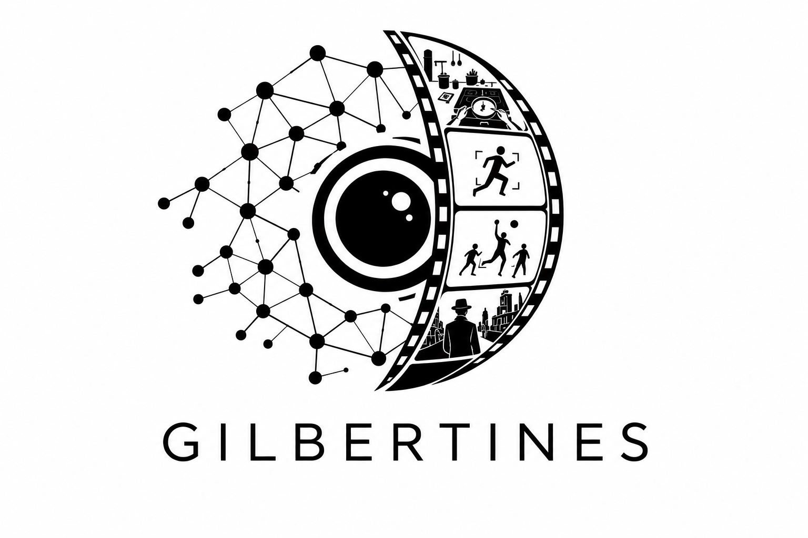

# Gilbertine Resources
### Templates and guidance for the Gilbertine research group

[<i class="fas fa-map-marker-alt"></i> Centre for Creative Arts and Technologies](https://c-cats.ac/)  
Department of Music and Media, Faculty of Arts and Social Sciences, University of Surrey

[Andrew Gilbert's homepage](../)

**Browse:** [Confirmation](#confirmation) · [Thesis](#thesis) · [GPU resources](#gpu-resources) · [CDT](#cdt) · [Logos](#gilbertine-logos)

---

## Expectation of a PhD Student

Tips and hints to provide you with an idea of what is expected of a PhD candidate. Modified from a version produced by [Simon Hadfield](https://www.surrey.ac.uk/people/simon-hadfield) in 2019 & and [Rich Bowden](https://www.surrey.ac.uk/people/richard-bowden) in 2013

**[Download the Expectations of a PhD Student (PDF)](expectations/ExpectationsofaPhDstudent2025.pdf)**

## Confirmation

Templates, guidance and examples for preparing your PhD confirmation report.

**[Download the Confirmation Template (ZIP)](confirmation/Template_Gilbertines_PhD_Confirmation_Report.zip)**

Download and extract the ZIP file to get started.

---

## Thesis

Thesis formats and guidance for planning, structuring and writing your PhD thesis.

**[Download the PhD Thesis Template (ZIP)](thesis/Gilbertines_PhD_Thesis_Template.zip)**

Download and extract the ZIP file to get started.

---

## GPU resources

GPU availability, server access and practical computing guidance for the group.

**[Open GPU resources — group password required →](gpu.html)**

Ask Andrew Gilbert for the group password.

---

## CDT

Resources and guidance for students on the Centre for Doctoral Training programme.

**[Open the CDT calendar →](https://dmicdt.github.io/cdt3-calendar/)**

---

## Gilbertine logos

Logos for presentations, posters and other group materials.

- <a href="gilbertinelogo/LogoMultiColour2026.png" download>Colour logo (PNG)</a>
- <a href="gilbertinelogo/LogoSingleColour2026.png" download>Single-colour logo (PNG)</a>
- <a href="gilbertinelogo/LogoSingleColour2026_NoText.png" download>Single-colour logo without text (PNG)</a>
- <a href="gilbertinelogo/LogoWhite2026.png" download>White logo (PNG)</a>
- <a href="gilbertinelogo/AnimatedLogo2026.mov" download>Animated logo (MOV)</a>
- <a href="gilbertinelogo/ChatGPT%20Image%20Aug%2027%2C%202026%2C%2010_20_35%20AM.png" download>Additional group artwork (PNG)</a>